# E-Ink Panel (`800×480`) Theme & Concept Gallery

This directory contains the 7 championship **native ESPHome C++ display themes** for [`displays/eink-panel.yaml`](../../eink-panel.yaml), along with golden PNG snapshots generated via ESPHome's `host` platform (`pytest`) in [`tests/__snapshots__/`](../../../tests/__snapshots__/).

To switch the active layout on `eink-panel`, update the single `!include` line in [`displays/packages/eink-panel-display.yaml`](../eink-panel-display.yaml).

---

## 1. Native ESPHome C++ Themes (`displays/packages/themes/*.yaml`)

### WF-03: R-P1 Split-Contrast × Yr.no Halftone Meteogram *(Active Default)*
- **Package**: [`eink-panel-wf03-meteogram.yaml`](eink-panel-wf03-meteogram.yaml)
- **Fonts**: `Montserrat Black`, `Gotham Rounded Bold/Book`, `Space Mono Bold`, `Material Design Icons`

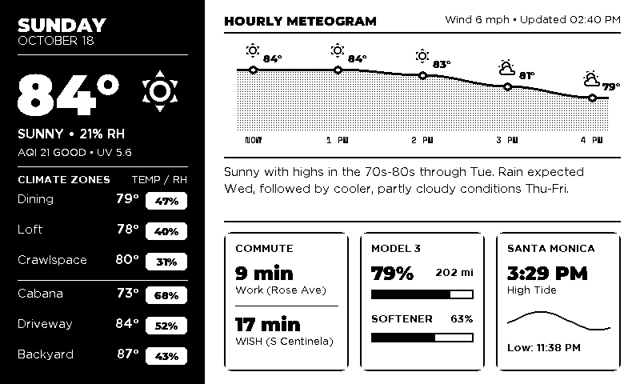

---

### WF-01: Architectural Property Cutaway × Meteogram Sky
- **Package**: [`eink-panel-wf01-cutaway.yaml`](eink-panel-wf01-cutaway.yaml)
- **Fonts**: `Bebas Neue`, `Share Tech Mono`, `Montserrat Black`, `Gotham Rounded`

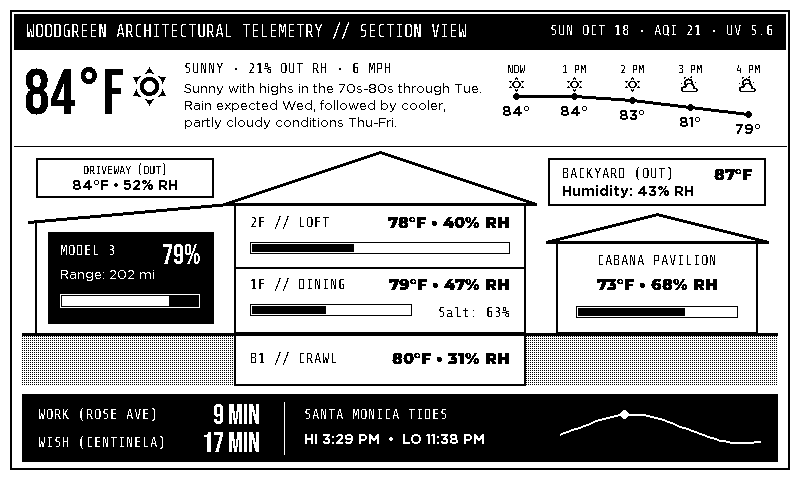

---

### WF-02: Solari Split-Flap × JR Express Departure Board
- **Package**: [`eink-panel-wf02-splitflap.yaml`](eink-panel-wf02-splitflap.yaml)
- **Fonts**: `Bebas Neue`, `Share Tech Mono`, `Gotham Rounded Book`

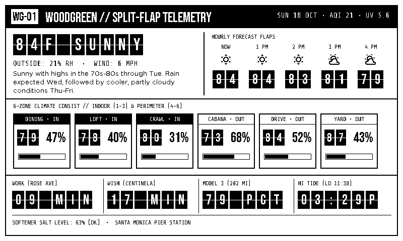

---

### WF-04: The Woodgreen Editorial Broadsheet & Almanac
- **Package**: [`eink-panel-wf04-broadsheet.yaml`](eink-panel-wf04-broadsheet.yaml)
- **Fonts**: `DM Serif Display` (Regular & Italic), `Bebas Neue`, `Gotham Rounded Bold`

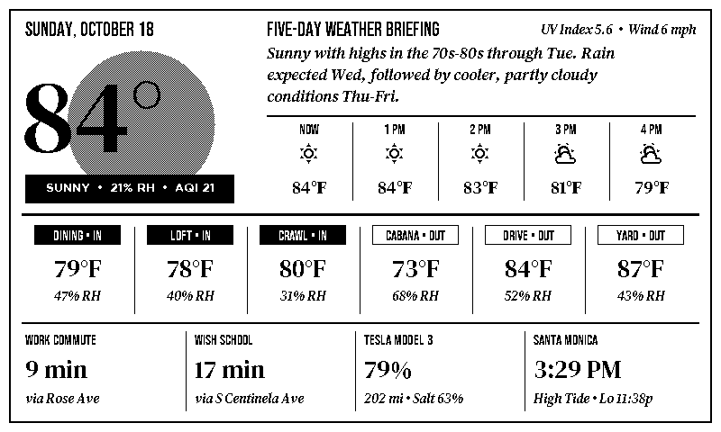

---

### WF-05: 1984 Apple Macintosh System 1 / HyperCard Desktop v2
- **Package**: [`eink-panel-wf05-macos1984.yaml`](eink-panel-wf05-macos1984.yaml)
- **Fonts**: `Silkscreen` (Bold & Regular), `VT323`

---

### WF-06: Casio G-Shock × Teenage Engineering Field Chrono v2
- **Package**: [`eink-panel-wf06-fieldchrono.yaml`](eink-panel-wf06-fieldchrono.yaml)
- **Fonts**: `Chakra Petch` (Bold & Regular)

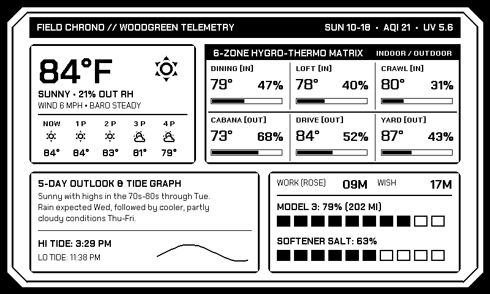

---

### BAL-01: R-P1 Balanced v2 (5 Hourly Columns + White RH% Pills)
- **Package**: [`eink-panel-bal01-rp1-v2.yaml`](eink-panel-bal01-rp1-v2.yaml)
- **Fonts**: `Montserrat Black`, `Gotham Rounded Bold/Book`

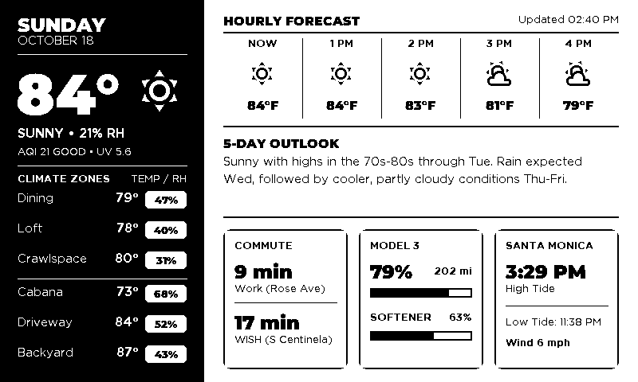

---

## 2. Full Tournament Concept Gallery (`tests/__snapshots__/test_eink_panel_concepts/`)

### Wild Round 1 Departures (`W1-01` .. `W1-10`)

| Concept | Preview |
| :--- | :--- |
| **W1-01: Solari Split-Flap Board** | 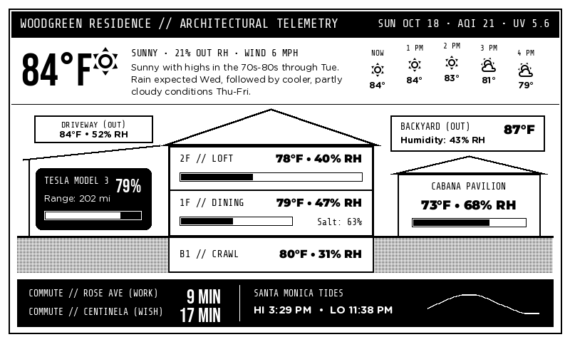 |
| **W1-02: The Woodgreen Dispatch Broadsheet** | 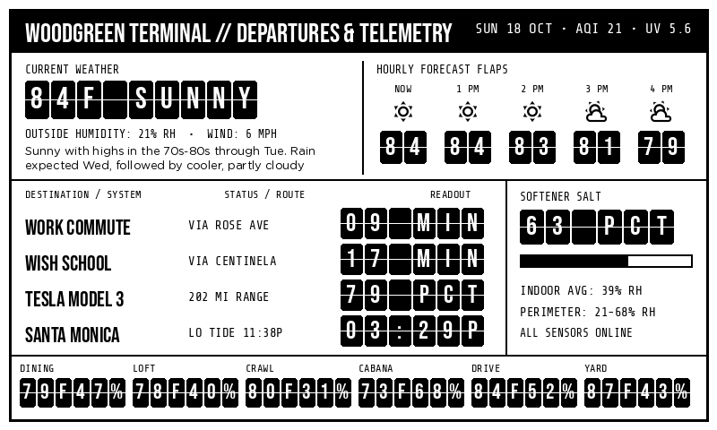 |
| **W1-03: Architectural Blueprint Cutaway** | 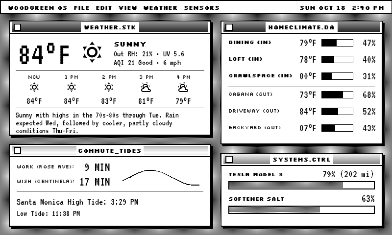 |
| **W1-04: 1984 Macintosh System 1 Desktop** | 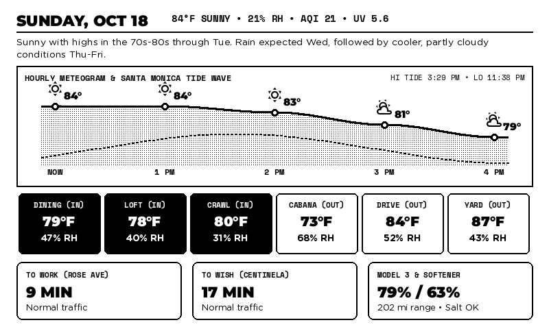 |
| **W1-05: Casio G-Shock Field Watch** | 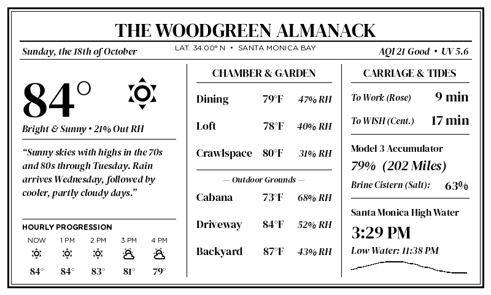 |
| **W1-06: UNIX `tmux` / `btop` Terminal** | 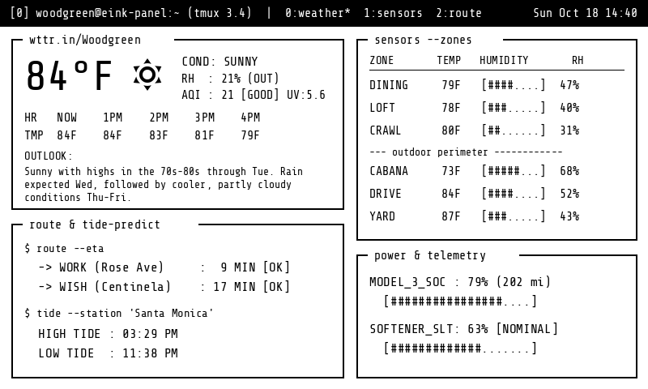 |
| **W1-07: Yr.no Full-Width Halftone Meteogram** | 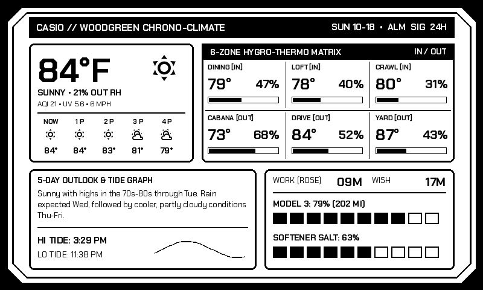 |
| **W1-08: Star Trek LCARS Biocomputer** | 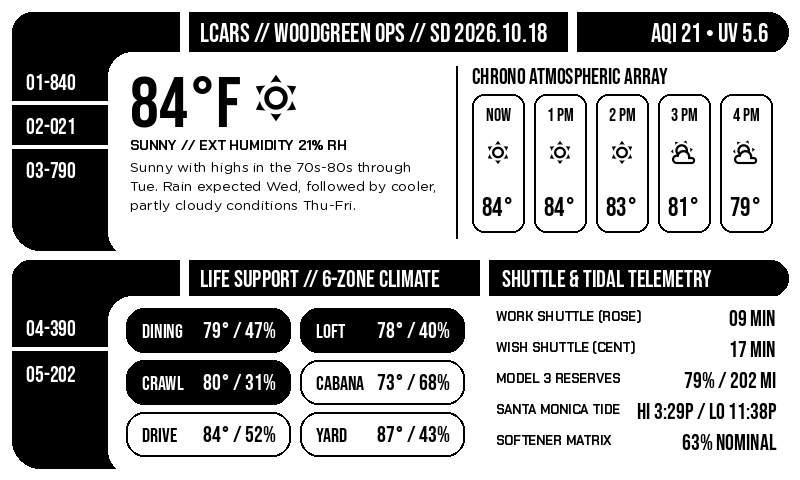 |
| **W1-09: JR Shinkansen 6-Car Train Consist** | 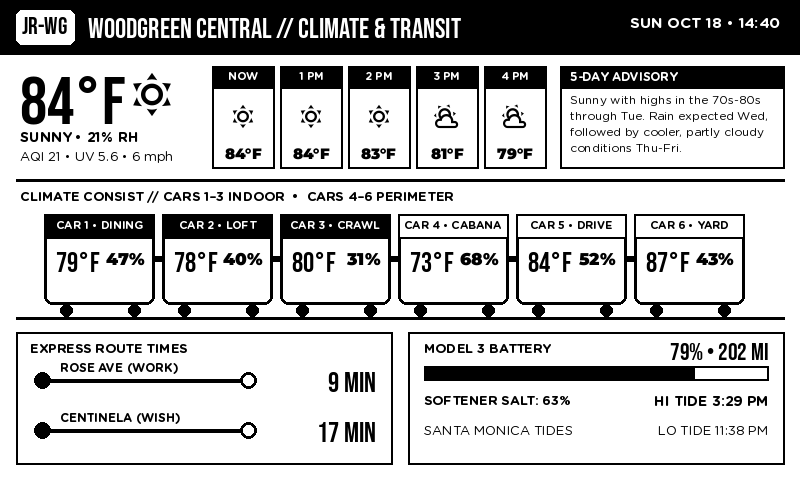 |
| **W1-10: Bauhaus / Constructivist Poster** | 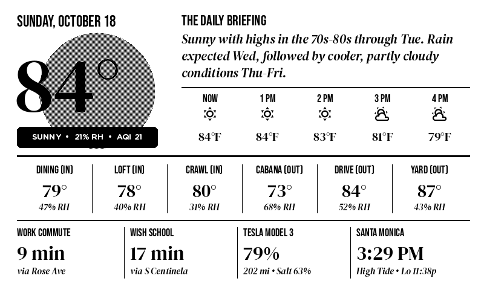 |

---

### Balanced Grid & Split Explorations (`BAL-01` .. `BAL-08`)

| Concept | Preview |
| :--- | :--- |
| **BAL-01: R-P1 Balanced v2** | 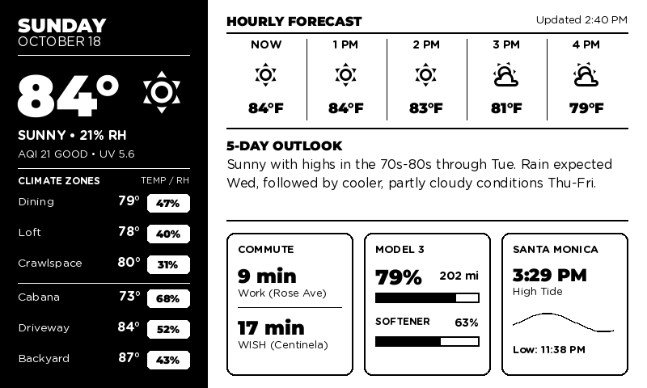 |
| **BAL-02: Weather Station 3-Tier** | 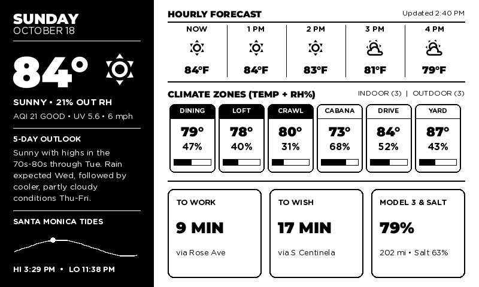 |
| **BAL-03: Executive 4-Quadrant Grid** | 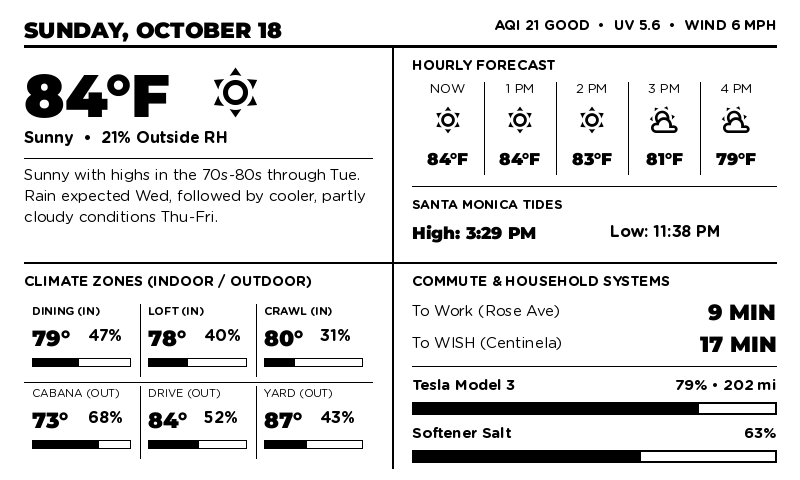 |
| **BAL-04: 8-Card Bento Grid** | 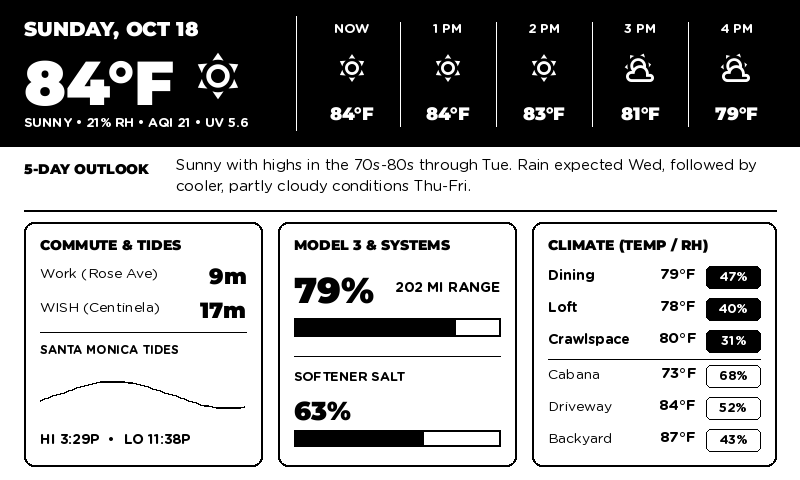 |
| **BAL-05: Swiss Newspaper Broadsheet** | 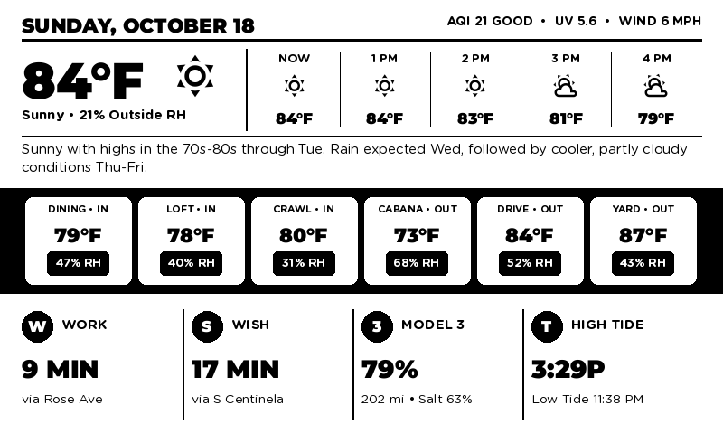 |
| **BAL-06: Dark Telemetry Deck** | 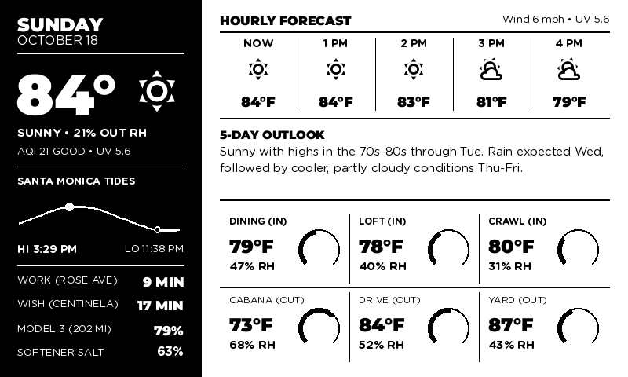 |
| **BAL-07: Nordic 4-Column Vertical** | 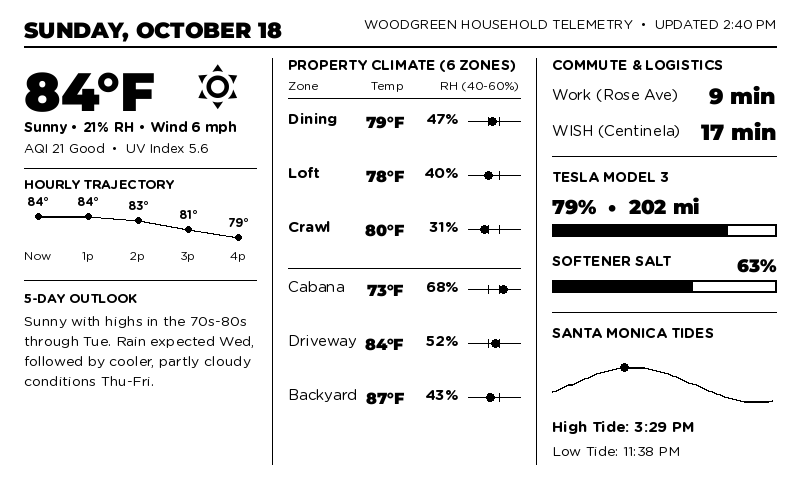 |
| **BAL-08: Right Black Anchor** | 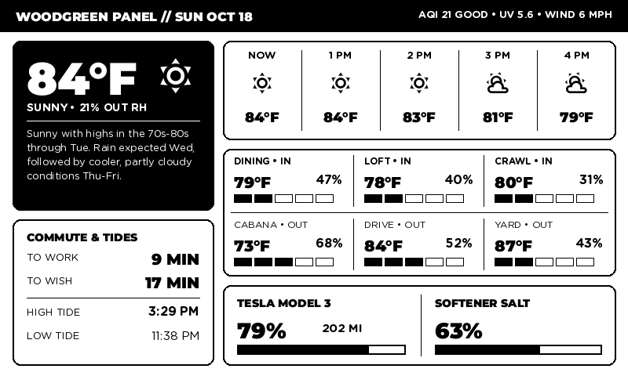 |
